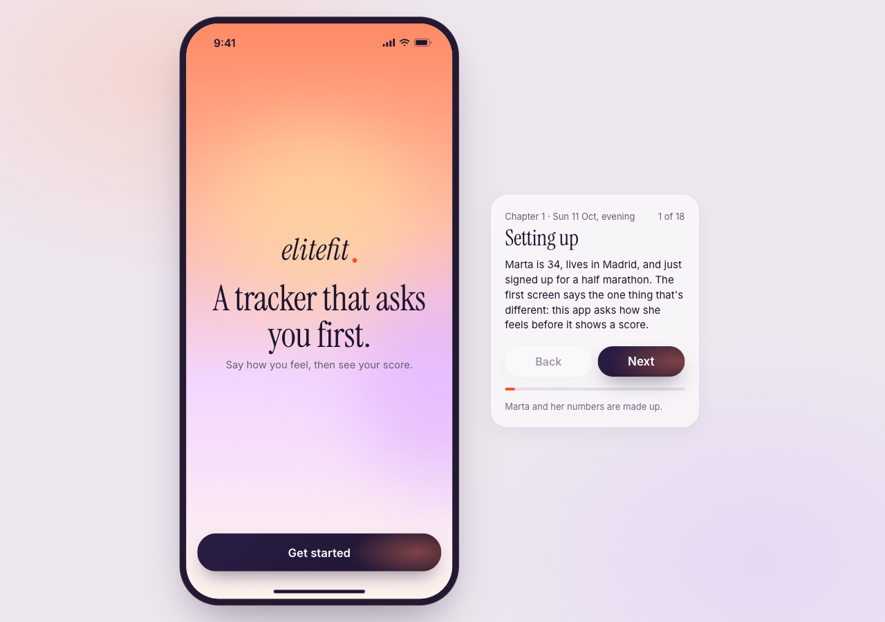
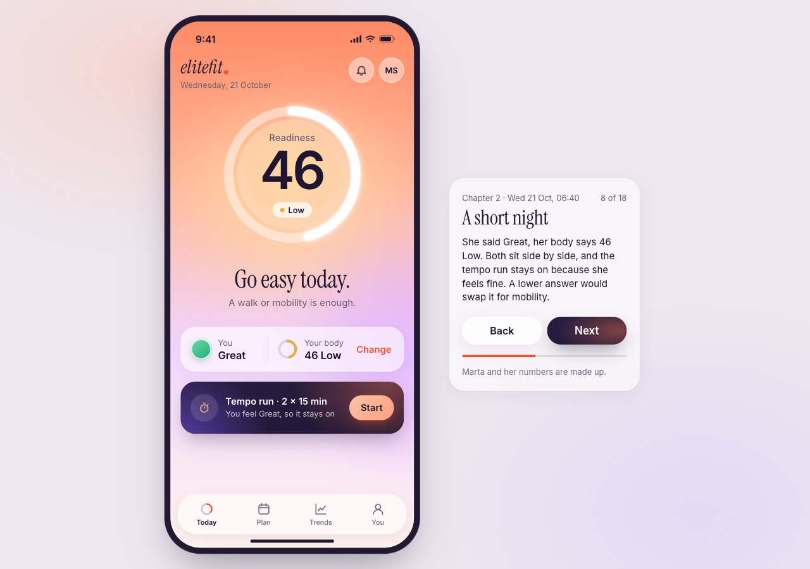
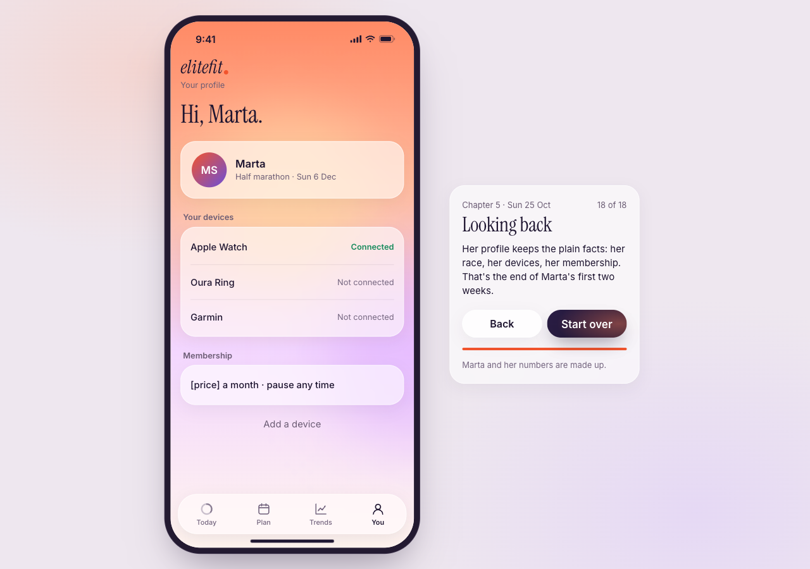

# EliteFit story prototype

A clickable prototype of EliteFit, a health tracker that asks how you feel before it shows your score. It follows Marta through two weeks of training for a half marathon, in 21 screens, 5 chapters and an appendix. The panel beside the phone says what's happening and why each screen looks the way it does. Back and Next walk the story in order, and tapping inside the app works too.

## How to open it

Double-click `index.html`. It also runs as is on GitHub Pages or Vercel, with no build step. Each screen has its own link, for example `index.html#today` or `index.html#sync-failed`.

Marta and her numbers are made up.

Built with Claude from the Figma design.
